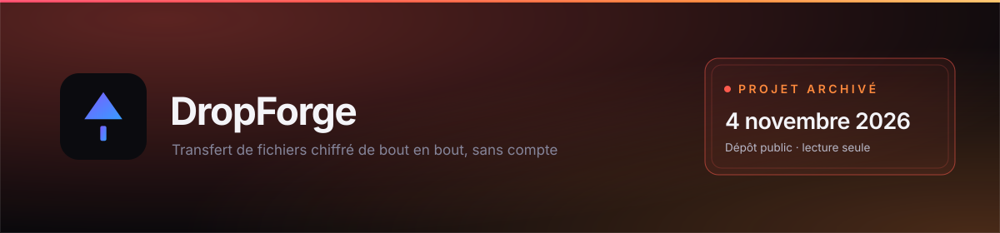

<p align="center">
  
</p>

# DropForge

> 🛑 **Projet archivé le 4 novembre 2026.**
> Le développement est définitivement arrêté : aucune nouvelle fonctionnalité, aucun correctif,
> aucune réponse de support. Le dépôt reste **public et en lecture seule**, conservé comme archive
> de ce qui a été construit.

| | |
| --- | --- |
| **État** | 🔴 Archivé — développement arrêté |
| **Date d'archivage** | 4 novembre 2026 |
| **Dernière version publiée** | [0.1.3](https://github.com/Louxos/DROPForge/releases/tag/v0.1.3) — 16 octobre 2026 |
| **Dernier état du code** | 0.2.0, jamais publiée comme version (voir la [chronologie](#chronologie)) |
| **Licence** | Aucune — le code est consultable, pas librement réutilisable |
| **Page publique** | <https://louxos.github.io/DROPForge/> — page d'archive |

<p align="center">
  
</p>

## Pourquoi cette archive

DropForge a été mené par une seule personne, bénévolement, sur un sujet qui touche au réseau
pair-à-pair, à la cryptographie, au stockage local et à trois moteurs de navigateurs. Chaque
version honnête demandait une vérification complète, et cette charge est devenue
disproportionnée face à ce que le projet apportait encore.

Le même besoin est aujourd'hui couvert par des outils installés, financés et suivis par des
équipes entières. Continuer aurait surtout produit une base de code de plus à maintenir seule.

Rester gratuit, enfin, était devenu un plafond : un relais public, des serveurs TURN, un
hébergement pour les liens de partage et des essais sur de vrais téléphones ne pouvaient pas
être tenus sérieusement sans financement. **Plutôt que de promettre ce qui ne pouvait pas être
tenu, le projet s'arrête** — et tout ce qui a été construit reste lisible ici.

## Ce que DropForge devait faire

Envoyer un fichier d'un appareil à l'autre — Windows, Android, iOS, n'importe quel
navigateur — **sans compte obligatoire, sans service payant, et en direct dès que le réseau le
permet**. Quand un serveur s'en mêlait, il ne devait jamais voir le contenu des fichiers.

L'ordre des méthodes, et la première qui fonctionne réellement :

1. **Réseau local** — les deux appareils sont sur le même Wi‑Fi : le transfert ne sort pas du
   réseau local.
2. **Direct (WebRTC)** — un canal chiffré de bout en bout est négocié avec l'aide d'un serveur
   de signalisation qui ne voit passer que la négociation.
3. **Relais aveugle** — quand la connexion directe est impossible : le serveur relaie des
   octets déjà chiffrés qu'il ne peut pas lire.

Si aucune méthode ne fonctionnait, l'application le disait clairement. Elle n'affirmait jamais
qu'un réseau autorisait la connexion directe.

## État réel au moment de l'arrêt

Aucune 1.0 n'a jamais été publiée, et ce dépôt ne prétend pas le contraire. Voici ce qui
existait, ce qui était testé, et ce qui manquait — sans arrondi.

| Partie | État à l'arrêt |
| --- | --- |
| Moteur de transfert (chiffrement de bout en bout, reprise, vérification SHA‑256, file d'attente) | ✅ Implémenté et testé |
| Interface React/TypeScript partagée (FR/EN, thèmes sombre et clair) | ✅ Implémentée et testée au niveau du contrôleur et du rendu |
| Application web progressive (PWA) installable | ✅ Construite et servie ; **jamais essayée sur un téléphone réel** |
| Publication du site (page, application, page 404) sur GitHub Pages | ✅ Vérifiée avant et après publication, sans hébergeur tiers |
| Serveur de signalisation et relais aveugle (Node, WebSocket) | ✅ Implémenté et testé, **sans adresse publique retenue** |
| Tests automatisés (unitaires et d'intégration) | ✅ 477 tests, 43 fichiers, exécutés à chaque contrôle |
| Tests de bout en bout dans de vrais navigateurs (Chromium, Firefox, WebKit) | ⚠️ Écrits et versionnés ; **non rejoués dans cet environnement**, qui n'a pas de navigateurs |
| Essais sur appareils mobiles réels | ❌ Jamais faits — seule l'émulation est couverte |
| Liens de partage hébergés (fichier stocké, expirable) | ⚠️ Code client écrit et testé ; **aucun hébergement retenu**, donc indisponible |
| Deux appareils sur des réseaux différents | ❌ Non promis — il aurait fallu une adresse de relais publique |
| Licence | ❌ Aucune — décision jamais prise |

Le détail exigence par exigence, y compris ce qui manquait pour une 1.0 :
[docs/TECHNIQUE.md](docs/TECHNIQUE.md) § 10.

## Technologies

| Domaine | Choix |
| --- | --- |
| Langage et outillage | Node 22, npm workspaces, TypeScript strict, Vite |
| Interface | React, design system maison (charbon, violet et bleu électrique) |
| Application installable | PWA, service worker Workbox, manifeste, mode hors ligne |
| Transport | WebRTC (négociation et canal de données), WebSocket pour la signalisation |
| Cryptographie | WebCrypto et `@noble/hashes` — AES‑256‑GCM, X25519 et Ed25519, aucun algorithme maison |
| Qualité | Vitest (unitaire et intégration), Playwright (bout en bout), contrôles du site publié |
| Publication | GitHub Pages, sans hébergeur tiers, sans service payant |
| Abandonné en cours de route | Application de bureau Rust/Tauri, retirée en 0.1.3 au profit de la seule application web |

## Explorer le code

Rien n'est cassé volontairement, mais **rien n'est maintenu** : ce qui suit décrit l'état
laissé, pas une promesse de fonctionnement sur une machine d'aujourd'hui.

```bash
npm ci                 # dépendances (Node 22+)
npm test               # la suite automatisée
npm run dev:web        # l'application seule → http://localhost:5173
npm run lan            # deux appareils du même Wi‑Fi, voir docs/GUIDE.md § 4
npm run build:pages    # construit le site dans _site/
npm run publish:site   # met la copie publiée à la racine du dépôt
npm run check:pages    # vérifie le site et sa copie, sous leur vrai chemin
```

| Emplacement | Contenu |
| --- | --- |
| `packages/*` | Le métier, sans React ni DOM : `protocol`, `security`, `app-core`, `transfer-engine`, `connection-manager`, `device-manager`, `history`, `settings`, `sharing`, `notifications`, `design-system` |
| `apps/web` | Application web progressive (React + Vite) |
| `apps/signaling` | Serveur de signalisation et relais aveugle (Node, WebSocket) |
| `site/` | Gabarits de la page d'archive et de la page 404, avec leur feuille de style |
| `index.html`, `404.html`, `app/`, `favicon.svg`, `.nojekyll` | **Le site publié**, écrit par `npm run publish:site` : GitHub Pages sert ces fichiers-là, et `npm run check:pages` vérifie qu'ils sont identiques à ce que construisent `site/` et `apps/web` |
| `scripts/` | Construction du site, vérification avant et après publication, paquets et sommes de contrôle |
| `e2e/` | Tests de bout en bout dans de vrais navigateurs |
| `docs/` | [Guide](docs/GUIDE.md), [documentation technique](docs/TECHNIQUE.md), bannière d'archive |

## Documentation

| Document | Contenu |
| --- | --- |
| **[docs/GUIDE.md](docs/GUIDE.md)** | Installer, utiliser, mode « même Wi‑Fi », dépannage, publication |
| **[docs/TECHNIQUE.md](docs/TECHNIQUE.md)** | Architecture, données, sécurité, plateformes, tests, état réel, annexes générées |
| **[CHANGELOG.md](CHANGELOG.md)** | Ce qui a changé, version par version, et l'arrêt du projet |
| **[Site public](https://louxos.github.io/DROPForge/)** | La page d'archive, et [l'application](https://louxos.github.io/DROPForge/app/) telle qu'elle a été laissée |

Ces documents décrivent le projet **tel qu'il était**, pas ce qu'il serait devenu.

## Ce qui reste accessible

- **Le code source** : l'intégralité du dépôt, tel qu'il a été laissé.
- **L'historique** : chaque commit, depuis le premier — rien n'a été réécrit.
- **Les versions publiées** : [0.1.0 à 0.1.3](https://github.com/Louxos/DROPForge/releases),
  avec leurs archives et leurs sommes de contrôle.
- **L'application** : toujours servie à
  <https://louxos.github.io/DROPForge/app/>, **sans maintenance**. Elle reste utilisable
  entre deux appareils du **même réseau local** ; les transferts entre réseaux différents et
  les liens hébergés n'ont jamais eu l'infrastructure pour fonctionner.
- **Les tags de version** : `v0.1.0` à `v0.1.3`, plus le tag `archived-2026-11-04` qui marque
  la fermeture.

## Chronologie

| Date | Événement |
| --- | --- |
| 13 octobre 2026 | `v0.1.0` — première version publiée |
| 14 octobre 2026 | `v0.1.1` |
| 16 octobre 2026 | `v0.1.2`, puis `v0.1.3` : l'application Windows quitte le projet, la web reste seule |
| 2 novembre 2026 | Publication du site sur GitHub Pages, fin de tout hébergeur tiers (`0.2.0`) |
| 4 novembre 2026 | **Arrêt définitif et archivage du dépôt** (`archived-2026-11-04`) |

La version `0.2.0` est le dernier état du code. Elle a été construite, contrôlée et publiée sur
GitHub Pages, mais **n'a jamais reçu de version publiée** : l'arrêt du projet est intervenu
avant.

## Licence

Le projet n'a **jamais reçu de licence**, et l'archivage ne permet plus d'en ajouter une. Sans
fichier `LICENSE`, le code est consultable mais **pas librement réutilisable, modifiable ni
redistribuable** : le droit d'auteur s'applique par défaut. Les licences des dépendances
(toutes permissives) sont listées dans [docs/TECHNIQUE.md](docs/TECHNIQUE.md) § 13.

<p align="center">
  
</p>

## Contributions et support

**Aucun support n'est assuré.** Les issues et les pull requests sont figées par l'archivage du
dépôt : elles restent lisibles, mais plus personne ne les traitera. Aucune reprise du projet
n'est prévue.

Merci à celles et ceux qui ont suivi, testé ou commenté DropForge.
