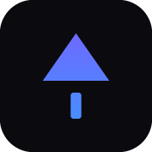

<p align="center">
  
</p>

# DropForge

**Transférez vos fichiers simplement, rapidement, et en toute sécurité.**

DropForge envoie des fichiers entre vos appareils — Windows, Android, iOS, n'importe quel
navigateur — sans compte obligatoire, sans service payant, et en privilégiant le transfert
direct d'un appareil à l'autre. Quand un serveur s'en mêle, il ne voit jamais le contenu
des fichiers.

<p align="center">
  <em>Un seul nom, deux coques : une application Windows (Tauri 2 + Rust) et une
  application web progressive (PWA) qui partagent exactement la même interface.</em>
</p>

---

## Documentation — quatre documents, pas plus

| Document | Contenu |
| --- | --- |
| **[docs/GUIDE.md](docs/GUIDE.md)** | Installer, s'en servir, **dépannage**, réparer une installation Windows coincée, publier, déployer |
| **[docs/TECHNIQUE.md](docs/TECHNIQUE.md)** | Architecture, comportement, données, sécurité, plateformes, tests, **état réel du projet**, annexes générées (dépendances, licences) |
| **[CHANGELOG.md](CHANGELOG.md)** | Ce qui a changé, version par version — c'est aussi le texte des notes de version publiées |
| **[Page d'accueil](https://louxos.github.io/DROPForge/)** | La vitrine publique : où aller, ce que DropForge fait, ses limites |

## Télécharger

| Vous êtes sur | Prenez | Comment |
| --- | --- | --- |
| **Ordinateur, téléphone, tablette** | l'application web | l'adresse publiée (Netlify, ou la vôtre : [docs/GUIDE.md](docs/GUIDE.md) § 9-10), puis « Installer l'application » / « Sur l'écran d'accueil » |
| **Windows** | l'installateur | page **[Releases](../../releases/latest)** → `DropForge_<version>_x64-setup.exe` (par utilisateur, sans droits administrateur) ou le `.msi` |
| **Un réseau isolé** | l'archive hors ligne | `dropforge-pwa-<version>.zip` de la dernière version, servi en **HTTPS** depuis n'importe quel dossier |
| **Deux réseaux différents** | le serveur optionnel | `dropforge-signaling-<version>.zip` : `npm install --omit=dev && npm start` |
| **Un serveur à vous** | les conteneurs | `cd deploy && docker compose up -d --build` → `http://localhost:8080` |

Sommes de contrôle, installation, et réparation d'une installation Windows bloquée :
[docs/GUIDE.md](docs/GUIDE.md) § 3 et § 7.

## État réel du projet

DropForge n'est **pas** encore une 1.0, et il le dit. Version actuelle : **0.1.2**.

| Partie | Statut |
| --- | --- |
| Moteur de transfert (chiffrement de bout en bout, reprise, vérification SHA-256, file d'attente) | ✅ Implémenté et **testé** (480 tests automatisés, 45 fichiers) |
| Interface partagée React/TypeScript (FR/EN, thèmes sombre et clair) | ✅ Implémentée et **testée** au niveau du contrôleur et du rendu |
| Application web progressive (PWA) installable | ✅ Implémentée et **testée** — pas encore essayée sur un téléphone réel |
| Serveur de signalisation / relais aveugle (Node) | ✅ Implémenté et **testé** |
| Application Windows (Tauri + Rust) | ⚠️ **Compilée et empaquetée** à chaque envoi par la chaîne d'intégration — **jamais ouverte sur un vrai Windows**, c'est la seule chose qu'elle ne peut pas faire |
| Installateur et désinstallateur Windows | ⚠️ **Corrigé en 0.1.2** (écran de démarrage qui restait affiché, désinstallation refusée) ; correctifs **pas encore essayés** sur un poste réel |
| Tests dans un vrai navigateur (E2E) | ✅ **Exécutés à chaque envoi** : Chromium, Firefox, WebKit (iPhone), transfert réel avec octets reçus hachés et comparés |
| Tests sur appareils mobiles réels | ❌ Non exécutés — l'émulation est couverte, pas un vrai iPhone/Android |
| Liens de partage hébergés | ⚠️ Code client implémenté et testé ; nécessite un hébergement (optionnel) |

Le détail exigence par exigence, avec ce qui manque pour une 1.0 :
[docs/TECHNIQUE.md](docs/TECHNIQUE.md) § 10.

## Comment DropForge se connecte

Dans l'ordre, **la première méthode qui fonctionne réellement** :

1. **Réseau local** — les deux appareils sont sur le même réseau : le transfert ne sort
   jamais du réseau local.
2. **Direct (WebRTC)** — réseaux différents : un canal chiffré de bout en bout est négocié
   avec l'aide d'un serveur de signalisation qui ne voit passer que de la négociation.
3. **Relais aveugle** — quand la connexion directe est impossible : le serveur relaie des
   octets déjà chiffrés qu'il ne peut pas lire.

Si aucune méthode ne fonctionne, DropForge le dit clairement et propose une alternative.
**Il n'affirme jamais qu'un réseau autorise la connexion directe.**

## Démarrage rapide (développement)

Prérequis : **Node 22+** et npm. Rust n'est nécessaire que pour l'application Windows.

```bash
npm install

npm run dev            # application web + signalisation (une seule commande)
npm run dev:web        # application web seule → http://localhost:5173
npm run dev:signaling  # signalisation seule → http://localhost:8787

npm run verify         # ce que la chaîne d'intégration exige : types, contrôles, 480 tests
npm test               # 45 fichiers, 480 tests
npm run test:e2e       # navigateurs réels (Chromium, Firefox, WebKit) — à installer une fois :
npm run test:e2e:install

npm run build:windows  # installateur Windows (Rust requis)
npm run package        # archives web + serveur et sommes de contrôle dans release/
```

Pour utiliser DropForge entre deux appareils, ouvrez l'application sur les deux. Le serveur
de signalisation n'est nécessaire que pour les transferts **distants** : sur le même réseau
local, l'application fonctionne sans lui.

## Structure du dépôt

| Emplacement | Contenu |
| --- | --- |
| `packages/*` | Le métier, sans React ni DOM : `protocol`, `security`, `app-core`, `transfer-engine`, `connection-manager`, `device-manager`, `history`, `settings`, `sharing`, `notifications`, `design-system` |
| `apps/web` | Application web progressive (React + Vite) — l'interface partagée |
| `apps/desktop` | Application Windows (Tauri 2 + Rust) et les hooks de l'installateur |
| `apps/signaling` | Serveur de signalisation / relais aveugle (Node, WebSocket) |
| `deploy/` | nginx, Dockerfiles et `docker-compose.yml` : tout sur une seule origine |
| `site/` | Sources de la page d'accueil publiée (générée par `npm run site:build`) |
| `e2e/` | Tests de bout en bout dans de vrais navigateurs |
| `scripts/` | Outils : icônes, paquets, page publiée, inventaire des dépendances, déblocage Windows |

## Sécurité et confidentialité

Aucun compte obligatoire, aucune télémétrie — ni par défaut ni en option. Le contenu est
chiffré de bout en bout (WebCrypto et `@noble/hashes`, aucun algorithme maison), les clés
privées ne quittent pas l'appareil, et les journaux ne contiennent ni secret ni contenu de
fichier. Ce qui **n'est pas** protégé est écrit noir sur blanc :
[docs/TECHNIQUE.md](docs/TECHNIQUE.md) § 5 et § 6.

## Contributions

Les contributions, idées et retours sont bienvenus. Avant de proposer une modification,
vérifiez l'état réel dans [docs/TECHNIQUE.md](docs/TECHNIQUE.md) § 10 : une fonctionnalité
marquée « partiel » ou « non testé » ne doit pas être présentée comme terminée.

## Licence

La licence du projet reste **à définir**. Tant qu'aucun fichier `LICENSE` n'est présent, le
code n'est pas automatiquement réutilisable, modifiable ni redistribuable. Les licences des
dépendances (toutes permissives) sont dans
[docs/TECHNIQUE.md](docs/TECHNIQUE.md) § 12.

## Soutenir le projet

En suivant son évolution, en partageant vos idées, en signalant les problèmes et en
contribuant à son amélioration.

Merci de votre intérêt pour DropForge.
